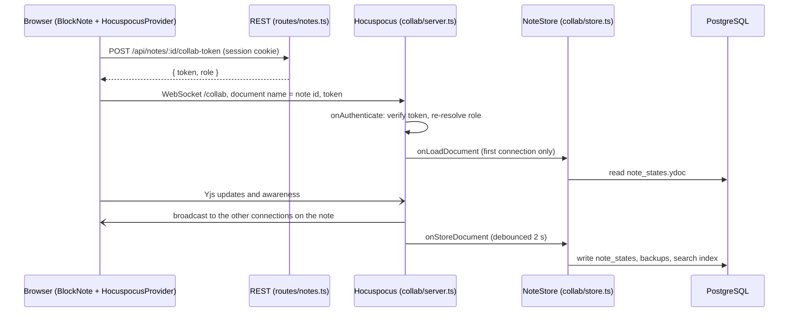

# Architecture

This is a map of the Knotebook code for someone who has never opened it. It covers how the pieces fit together and names the files where each part lives. It does not repeat the user-facing behaviour, which is in [`docs/`](docs/); the [API contract](docs/api.md), [MCP](docs/mcp.md) and [AI editing](docs/ai-editing.md) docs are the reference for what the endpoints and tools promise.

Source comments are in English and only explain *why* the code is shaped the way it is where the code can't show it: lock and transaction order, invariants enforced elsewhere, preconditions, library quirks. When this document points at a file, read the code together with those comments.

## Repository layout

Knotebook is a pnpm workspace (`pnpm-workspace.yaml`) with three packages and an end-to-end suite:

| Path | What lives there |
|---|---|
| `apps/server` | `@knotebook/server`: the Node.js/TypeScript backend. One Fastify process serves the REST API, the `/collab` WebSocket, the MCP endpoint, OAuth and the built web app. |
| `apps/web` | `@knotebook/web`: the React single-page app, built with Vite. The editor is BlockNote. |
| `packages/shared` | `@knotebook/shared`: code and types used by both sides, such as the note schema, Markdown conversion rules, DTOs, presence fields, site-limit definitions and collab close codes. Both apps import it as `workspace:*` and it has to be built (`dist/`) before either app runs. |
| `e2e` | `@knotebook/e2e`: the Playwright suite, run against a Docker Compose stack (`docker-compose.yml` plus `docker-compose.e2e.yml`). `e2e/stubs` holds a fake OIDC provider and an AI stub. |
| `docker/Dockerfile` | The app image: builds all packages, deploys the server, and copies the web build next to it as `web-dist`. |
| `docker-compose.yml` | The self-hosting stack: the `app` service and a bundled PostgreSQL (`db`, the `pgvector/pgvector:pg17` image). |
| `scripts` | Repository scripts: license check, bundle-size check, Markdown link check, release preparation, CHANGELOG section extraction, PWA icon generation, and the WSL wrappers for integration and e2e tests. Each `.mjs` has a `.test.mjs` next to it (`pnpm test:scripts`). |
| `patches` | Patches applied to third-party packages with `pnpm patch` (see [Patched dependencies](#patched-dependencies)). |
| `docs` | User, operator and contributor documentation. |

## The server (`apps/server`)

### Startup

`apps/server/src/index.ts` is the entry point. In order, it:

1. reads the environment (`loadConfig` in `apps/server/src/config.ts`);
2. opens the PostgreSQL pool and runs the Drizzle migrations (`apps/server/src/db/migrate.ts`), then idempotent seeds;
3. loads the site limits (`apps/server/src/site-limits/store.ts`), which combine environment variables, values saved in Site admin, and defaults;
4. creates the first admin account on an empty database (`apps/server/src/auth/bootstrap.ts`, from `ADMIN_EMAIL`/`ADMIN_PASSWORD`) and runs a few idempotent backfills that must finish before the server accepts requests;
5. creates the collaboration server (`createCollabServer` in `apps/server/src/collab/server.ts`);
6. builds the Fastify app (`buildApp` in `apps/server/src/app.ts`) and listens on port 3000;
7. after listening, starts background work: the search index backfill and a one-time link conversion.

On `SIGTERM`/`SIGINT` it stops background scans, then calls `collab.destroy()` **before** `app.close()`: Fastify does not close sockets that were upgraded to WebSockets, and destroying the collab server is what flushes unsaved documents to the database.

### HTTP app and routes

`buildApp` in `apps/server/src/app.ts` wires everything together. It sets up cookie, multipart and form parsing, a global `onRequest` guard that requires `application/json` on bodies (with exemptions for uploads, `text/markdown` file write-backs and the OAuth form endpoints), the shared error format, security headers, `/healthz`, and the rate limiters (`apps/server/src/http/limiters.ts`). Then it registers one Fastify plugin per area from `apps/server/src/routes/`, for example:

- `routes/notes.ts`: notes and the collab token; it also registers `routes/note-content.ts` (a note's content, `GET /api/notes/:id/content`, and edits and reverts, `/api/notes/:id/edits`) and `routes/note-sharing.ts` (shares, the public link and its alias and width);
- `routes/note-versions.ts`, `routes/trash.ts`, `routes/folders.ts`, `routes/favorites.ts`, `routes/tags.ts`, `routes/groups.ts`, `routes/search.ts`, `routes/knowledge.ts` (the knowledge index of a space or folder and the replacement lookup, session-only), `routes/uploads.ts`;
- `routes/auth.ts`, `routes/oidc*.ts`, `routes/api-tokens.ts`, `routes/oauth*.ts`: sign-in and credentials (next section);
- `routes/admin-*.ts`: Site admin;
- `routes/mcp.ts`: the MCP endpoint, `POST /api/mcp`;
- `routes/transfer.ts`: bulk download and write-back of notes as files (`/api/transfer/*`);
- `routes/public.ts`: public links, without sign-in;
- `routes/ai.ts`: the in-app AI actions (provider code in `apps/server/src/ai/`).

Routes stay thin. Domain logic lives in folders named after the area (`notes/`, `folders/`, `groups/`, `trash/`, `tags/`, `knowledge/`, `uploads/`, `storage/`, `transfer/`, `avatars/`), and code that runs inside a database transaction is usually in a `tx/` subfolder (for example `apps/server/src/notes/tx/`).

The `/collab` WebSocket does not go through Fastify routing: `collab.attach(app)` listens to the underlying HTTP server's `upgrade` event. Anything that matches no route falls through to `registerSpaFallback` (`apps/server/src/http/spa.ts`), which serves `index.html` from `web-dist` for browser navigations.

`/collab/notifications`, the notification bell's socket, is dispatched from inside the same `upgrade` handler (a second listener would race it) to the hub in `apps/server/src/notifications/hub.ts`. It authenticates by session cookie, not by a token, so its upgrade also passes the `Origin` check in `apps/server/src/http/origin.ts`. It sends only `{"type":"notification"}`; the browser refetches over REST with its own permissions.

### Authentication

There are four kinds of credentials:

- **Web sessions.** Signing in (password: `routes/auth.ts`; OIDC: `routes/oidc.ts`) inserts a row in the `sessions` table and sets a signed JWT cookie that names it (`apps/server/src/auth/session.ts`, `apps/server/src/auth/sessions.ts`). `UserGate` in `auth/session.ts` checks every request against the user and session rows, with a small in-memory cache, so signing out, disabling an account or changing a password takes effect on the next request. Routes use the `app.authenticate` decorator (cookie only) or `app.requireAdmin`.
- **OIDC sign-in.** Identity providers are configured in Site admin and stored in the database (`auth_providers`, `user_identities`). The flow uses `openid-client` (`apps/server/src/auth/oidc-*.ts`, `apps/server/src/auth/tx/oidc-login.ts`).
- **API tokens and OAuth grants.** Both live in the `api_tokens` table as hashes (`kind` tells them apart). A personal token is created in Settings (`routes/api-tokens.ts`). MCP clients can instead use OAuth with dynamic client registration and PKCE: `routes/oauth.ts` serves `/oauth/register`, `/oauth/authorize` and `/oauth/token`, `routes/oauth-metadata.ts` the `/.well-known/` metadata, and `routes/oauth-api.ts` the consent page's API. Only routes that opt in with `app.authenticateTokenOrSession(scope)` (`apps/server/src/auth/bearer.ts`) accept a bearer token; everything else stays cookie-only, so a leaked token can read or write notes but cannot take over the account.
- **Collab tokens.** A short-lived JWT for one note, signed with a key separate from the session key (`apps/server/src/collab/token.ts`), issued by `POST /api/notes/:id/collab-token` (cookie only). See [Real-time collaboration](#real-time-collaboration).

### Database and migrations

PostgreSQL, accessed through Drizzle ORM. The whole schema is in `apps/server/src/db/schema.ts`. Tables you will meet early:

- `users`, `sessions`, `api_tokens`, `auth_providers`, `user_identities`: accounts and credentials;
- `notes`: metadata (title, slug, owner or group, folder, trash state, last edited, pending version state);
- `note_states`: the note's content, one Yjs document per note stored as bytes (`ydoc`), with an optimistic-lock `version`;
- `note_state_backups`: periodic copies of `note_states` (see [docs/backup-restore.md](docs/backup-restore.md));
- `note_versions`: version history, each version a full Yjs snapshot;
- `note_ai_edits`: the history of edits made over the API, MCP and file write-backs, used for revert;
- `note_search_sections`, `note_search_state`: the search index;
- `note_knowledge`, `note_knowledge_state`: the knowledge index;
- `note_shares`, `groups`, `group_members`, `group_roles`, `folders`, `note_placements`, `note_links`, `uploads`, `tags`, `note_tags` (a space's tag list and the tags each note carries).

Migrations are SQL files in `apps/server/drizzle/` (with Drizzle's journal in `apps/server/drizzle/meta/`), generated from the schema with `pnpm --filter @knotebook/server db:generate` (`drizzle-kit generate`, configured by `apps/server/drizzle.config.ts`). They run automatically at startup. New migrations are normally written so that the previous release still starts on the migrated database (the groups migration, 0012, is a documented exception that can't be rolled back): the CHANGELOG's upgrade notes and the [self-hosting guide](docs/self-hosting.md#upgrading-and-rolling-back) describe each one and what rolling back means.

### Single instance, and what is in memory

Knotebook supports exactly one `app` process ([Single-instance warning](docs/self-hosting.md#single-instance-warning)). Several pieces of state exist only in that process, with no coordination between processes:

- the Hocuspocus documents that are open, and the index of who is connected to which note (`collab/server.ts`);
- the notification bell's open sockets, per person (`notifications/hub.ts`): a notification committed on another process would not reach them;
- the per-note write queue that serializes every non-editor write (`NoteWriteQueue`, `apps/server/src/notes/editing/queue.ts`);
- agent presence (`PresenceRegistry`, `apps/server/src/notes/editing/presence.ts`);
- per-note version state between saves (`apps/server/src/collab/versions.ts`; pending versions are also written to the database, so a restart picks them up);
- rate limiters and the login throttle (`apps/server/src/http/rate-limit.ts`, `apps/server/src/auth/rate-limit.ts`) and the `UserGate` cache.

Two processes editing the same note would hold two diverging copies of it.

## Real-time collaboration

**Server.** `apps/server/src/collab/server.ts` uses the `Hocuspocus` class from `@hocuspocus/server` directly (not its bundled `Server`), mounted on Fastify's HTTP server with `ws` in `noServer` mode. One WebSocket can carry several documents; the document name is the note id. The file's header comment records the Hocuspocus 4 behaviours the code relies on.

**Authorization.** `onAuthenticate` verifies the collab token, then resolves the user's role on the note again from the database. The role inside the token is never trusted on its own. A viewer's connection is read-only. When a share is removed or an account is disabled, `apps/server/src/collab/hooks-impl.ts` (the `CollabHooks` interface in `apps/server/src/collab/hooks.ts`) asks the affected connections for a fresh token and closes those that don't come back with one in time. Deleting a note closes every connection to it first.

**Loading and saving.** `apps/server/src/collab/store.ts` (`createNoteStore`) writes `note_states` and `note_state_backups`. It is the only code that updates an existing note's state; the one other writer is copying a note (`apps/server/src/notes/tx/copy.ts`), which inserts the copy's first `note_states` row.

- `onLoadDocument` applies the stored `note_states.ydoc` to the in-memory document;
- `onStoreDocument` (debounced to 2 seconds, and forced when a direct connection disconnects) writes it back with an optimistic lock, writes a backup when a 15-minute bucket boundary is crossed (`apps/server/src/collab/backup-policy.ts`), and rewrites the note's search index when its text changed. A store for a note that no longer exists is dropped, so a deleted note can't come back.

`collab/server.ts` also stamps `notes.last_edited_*`, and feeds the version service (next section) from `onLoadDocument`, `onChange` and `onStoreDocument`.

**Presence.** Awareness from browsers is not trusted: `apps/server/src/collab/awareness-sanitize.ts` rebuilds each state from what the server knows about the connection (user, name, color, avatar, role) and keeps only a valid cursor from the client. Agents (API and MCP writers) appear as cursors through `PresenceRegistry`, which writes awareness states on the server side.

**Versions.** `apps/server/src/collab/versions.ts` marks a note as pending when stored content changed, and an in-process scan saves an automatic version once the note has been quiet for the configured time; manual saves go through `routes/note-versions.ts`. An hourly sweep prunes old automatic versions (`apps/server/src/collab/version-policy.ts`). Applying an old version (`apps/server/src/notes/editing/apply-version.ts`) uses the same write queue and merge as AI edits, but leaves no `note_ai_edits` record, so it can't be reverted from the edit history. User-facing rules: [docs/versions.md](docs/versions.md).

## Writes that don't come from the editor

MCP tools, the REST content endpoints, bulk file write-backs, applying a version and the link conversion all change notes without a browser editor. They share one pipeline in `apps/server/src/notes/editing/`:

- `NoteWriteService` (`write-service.ts`) is built once in `buildApp` and shared by the REST and MCP routes. It runs every write for a note through the same `NoteWriteQueue`, so writes to one note never interleave, then updates agent presence.
- Conversion runs in **parse workers**: a pool of `worker_threads` (`parse-pool.ts`, worker entry `parse-worker.ts`), each with its own jsdom and headless BlockNote editor (`runtime.ts`, `parse-core.ts`). Parsing written Markdown into BlockNote blocks always runs in a worker. Jobs on a note's Yjs state (reading it out as Markdown or an outline, applying an edit to a fork: `doc-jobs.ts`, through `EditingRuntime.runDoc`) also go to a worker, except for documents under `DOC_INLINE_MAX_BYTES`, which stay on the main thread. This keeps a large note from blocking HTTP and collaboration. The pool size and limits come from the site limits ([Parse workers](docs/self-hosting.md#parse-workers)).
- The change is computed on a **fork** of the note's Yjs state and merged back into the live document as a Yjs update, so text someone typed in the meantime survives. If the live document changed the blocks the write cares about, the write starts over (at most `DOC_MERGE_ATTEMPTS` times, then the caller gets a busy error).
- The merge happens through a Hocuspocus **direct connection** (`withDirectConnection` in `session.ts`), the only place that opens one. Direct connections bypass `onAuthenticate`, so callers must check permissions first. Disconnecting is what saves the document.
- Edits made over the API and MCP (`insertEditRecord` in `apply.ts`), reverts (`revert.ts`) and file write-backs (`apps/server/src/transfer/tx/record-file-sync.ts`) are recorded in `note_ai_edits` with the blocks they replaced, keeping at most `RETENTION` rows per note. Applying a version and the one-time link conversion (`apps/server/src/notes/link-conversion.ts`, which merges with `mergeDiff`) are not recorded. `revert.ts` and `revert-core.ts` undo a recorded edit when the blocks it wrote are still unchanged. The rules are in [docs/ai-editing.md](docs/ai-editing.md).

Markdown conversion itself (what syntax maps to which block, colors, columns, escaping) is in `packages/shared/src/note-markdown*.ts`, so the server and the web app agree on it. The knowledge comment under a heading is converted in `packages/shared/src/knowledge-html.ts` (`applyKnowledgeComments`, when markdown is written) and `knowledge-markdown.ts` (`formatKnowledgeComment`, when it is read).

### End to end: an agent calls `edit_note` and an open tab updates

1. The MCP client sends `POST /api/mcp`. The global JSON guard in `app.ts` runs, then `app.authenticateTokenOrSession` (`auth/bearer.ts`) resolves the bearer token from `api_tokens` and its scope.
2. The handler in `apps/server/src/routes/mcp.ts` creates a stateless `McpServer` for this one request, registers the tools allowed by the token's scope (`registerMcpTools` in `apps/server/src/mcp/register.ts`), and hands the request to the SDK's `WebStandardStreamableHTTPServerTransport` (the Fastify/Web bridge is `apps/server/src/mcp/transport.ts`).
3. The SDK calls `editNote` in `apps/server/src/mcp/tools/edit-note.ts` (through `runTool`, which turns unexpected exceptions into a tool error). In order, it checks the token's write scope (`requireWriteScope`, `apps/server/src/mcp/write-scope.ts`), validates the arguments against the same schema as REST `POST /api/notes/:id/edits` (`apps/server/src/notes/schemas.ts`; a `rename` branches off here and never touches the document), resolves the caller's role (`resolveRole` in `apps/server/src/notes/service.ts`), and takes from the `edit` rate limiter.
4. `NoteWriteService.applyToNote` (`notes/editing/write-service.ts`) works out the agent label and the notes that wikilinks may point to, and parses the Markdown in a parse worker (`editing.parser.parse`) **before** entering the per-note queue, so a slow parse doesn't hold up other writes to the note. It then runs `applyEdit` inside `NoteWriteQueue.run(noteId, …)`, passing the result as `preparsed`.
5. `applyEdit` (`apps/server/src/notes/editing/apply.ts`) takes the blocks from `preparsed` (its `prepareBlocks` parses only when nothing was pre-parsed), reads the note's current state with `loadNoteState` (`notes/editing/read.ts`, from the live document if it is loaded, otherwise from `note_states`) and starts watching the live document for changes (`live-watch.ts`). It then sends an `edit` job to a worker (`EditingRuntime.runDoc` → `executeDocOp` in `doc-jobs.ts`). The worker checks `if_match` against the section's fingerprint (`fingerprint.ts`), applies the operation to a fork in a headless editor, and returns the Yjs diff plus the new outline and fingerprints.
6. `mergeAtBase` (`apply.ts`) calls `withDirectConnection` (`notes/editing/session.ts`), which opens `hocuspocus.openDirectConnection(noteId, ctx)` (loading the document through `onLoadDocument` if no one has it open), checks again that the note is not being deleted or in the trash, and applies the diff to the live document in one transaction.
7. Hocuspocus broadcasts that update to every WebSocket on the note. In the open tab, the `HocuspocusProvider` created by `apps/web/src/collab/useCollab.ts` applies it to its `Y.Doc`, and BlockNote's Yjs binding (y-prosemirror) updates the editor.
8. The direct connection disconnects, which triggers `onStoreDocument` (`collab/store.ts`): `note_states` is saved, a backup may be written, the search index is rewritten, and `collab/versions.ts` marks the note as pending for an automatic version.
9. Back in `applyEdit`, `insertEditRecord` writes the `note_ai_edits` row (trimming the note's history to `RETENTION` rows) and `updateNoteLinks` refreshes `note_links`. When `applyEdit` returns, `applyToNote` updates the agent's presence, so its cursor shows at the changed section in open tabs. The tool replies with the `editId`, the new fingerprint and the outline.

REST `POST /api/notes/:id/edits` (`routes/note-content.ts`) takes the same path from step 4 on.

## Search

Search covers note titles and body text. The body is indexed one row per section in `note_search_sections`, with one `note_search_state` row per note recording which `note_states.version` and content hash the rows were built from:

- extraction: `apps/server/src/notes/search-text.ts`;
- writing: `apps/server/src/notes/search-index.ts` and `apps/server/src/notes/tx/search-index.ts`, called from `onStoreDocument`, when a note is copied, and by the backfill;
- backfill: `backfillSearchIndex` in `search-index.ts` runs in the background after the server starts listening, picking up notes whose index is missing or was built by an older extractor version. It can be resumed and is aborted on shutdown;
- querying: `apps/server/src/notes/search-sql.ts` builds the SQL (case-insensitive substring match on titles and sections, joined with the notes the user can see), `notes/search-query.ts` runs it, and `notes/search-snippet.ts` picks the snippets. REST (`routes/search.ts`) and MCP `search_notes` share it. A `pg_trgm` GIN index on `lower(note_search_sections.body)` (`nss_body_trgm_idx`) serves body matches for queries with three letters or digits in a row; shorter queries use `position()`. Which characters count depends on the database's `LC_CTYPE`, which the server checks once at startup (`initCjkTrigramMode` in `search-sql.ts`).

## Knowledge index

The knowledge info on headings is copied into `note_knowledge` (one row per knowledge id), with one `note_knowledge_state` row per note recording the `note_states.version` and content hash the rows were built from. The document stays the source of truth; the tables are a cache.

- extraction: `apps/server/src/knowledge/extract.ts` builds the rows from the document and never throws; a document whose bytes don't contain a knowledge attribute is not walked;
- writing: `apps/server/src/knowledge/index-write.ts` and `knowledge/tx/index-write.ts`, called from `onStoreDocument` after the full-text index (a failure there never fails the store), when a note is copied, and by the backfill;
- backfill: `backfillKnowledgeIndex` runs in the background after the server starts listening and then every ten minutes (`startKnowledgeIndexSweep`), picking up notes whose index is missing, was built by an older extractor version, or lags the stored note. A note whose stored document can't be decoded is recorded as empty and capped, so it stops being picked up. It can be resumed and is aborted on shutdown;
- reading: `knowledge/index-query.ts` answers `GET /api/knowledge/index/*` in one repeatable-read, read-only transaction. `knowledge/scope.ts` first decides, outside the transaction, which personal space, group or folder the caller may open (everything else is one "not found"); inside it, notes come only from the same visibility branches as the note list (`knowledge/index-sql.ts`), so a note in the trash or one the caller can't see never appears, and neither does a replacement that points at one. A response holds at most 5000 entries, cut on a whole-note boundary in page order. `GET /api/notes` adds `hasKnowledge`, an `exists` on the leading column of the `note_knowledge` primary key; `knowledge/refs.ts` serves the replacement picker's search and lookup.

## The web app (`apps/web`)

- **Entry and routing.** `apps/web/src/main.tsx` mounts `App` (`apps/web/src/App.tsx`), which uses React Router. The main tree renders pages from `apps/web/src/pages/` (sign-in, registration, the home page, `NotePage`, `PublicNotePage` for `/p/...`, OAuth `AuthorizePage`). A second tree renders Settings, group and Site admin panels as modals over the current page; the long comment above `AppRoutes` explains the two trees. Heavy pages, including the editor, are loaded lazily, and CI checks the size of the entry bundle (`scripts/check-bundle-size.mjs`).
- **Data.** REST calls go through `apps/web/src/api/client.ts` and one module per area in `apps/web/src/api/`, with TanStack Query.
- **Editor.** `apps/web/src/components/NoteEditor.tsx` creates the BlockNote editor (`useCreateBlockNote`) with the note schema shared with the server (`packages/shared/src/note-schema-config.ts`). Custom editor UI lives in `apps/web/src/components/editor/`. Presentation mode (reveal.js) is in `apps/web/src/present/`.
- **Collab client.** `apps/web/src/collab/useCollab.ts` fetches a collab token, creates the `Y.Doc` and `HocuspocusProvider` (same-origin `/collab`), retries with backoff, and reacts to the server's close reasons (revoked, note deleted, client outdated); the connection state machine is in `apps/web/src/collab/connection.ts`. The rest of `apps/web/src/collab/` holds editor behaviour that has to cooperate with Yjs: undo, paste, Markdown links, remote cursors (`remote-states.ts`), columns.
- **i18n.** i18next with English and Traditional Chinese: `apps/web/src/i18n/index.ts`, the main string files `en.json` and `zh-TW.json`, a few feature-specific pairs (`*.en.json`/`*.zh-TW.json`), and `blocknote-zh-TW.ts` for BlockNote's own strings. `apps/web/src/i18n/index.test.ts` checks that `en.json` and `zh-TW.json` have the same keys. The feature-specific packs are loaded lazily: each is registered by its `*-strings.ts` module and checked by its `*-copy.test.ts`.
- **Styling.** Tailwind CSS 4 (`apps/web/src/index.css`) and the theme in `apps/web/src/theme.tsx`, with `theme.*.test.ts` guards for specific CSS rules.

In development, Vite proxies `/api` and `/collab` to the server on port 3000 (`apps/web/vite.config.ts`). In production the server serves the built files itself.

## Patched dependencies

Two packages are patched with `pnpm patch`. The patch files are in `patches/` and are listed under `pnpm.patchedDependencies` in the root `package.json`:

- `y-prosemirror` (used by the web editor): when restoring a node selection after a Yjs change (undo, redo or a remote edit), the selected node may be gone. Upstream then throws inside the Yjs observer and the editor falls out of sync with the document; the patch falls back to a nearby text selection. Test: `apps/web/src/collab/node-selection-restore.test.ts`.
- `@blocknote/core` (used by the web app, `packages/shared` and the server's headless editors): adds `<` to the characters a backslash can escape in BlockNote's Markdown parser, so `\<b>` reads back as literal text. Test: `packages/shared/src/blocknote-backslash-lt.test.ts`. It is also recorded in `THIRD_PARTY_NOTICES.md`.

A patch is tied to an exact version, so upgrading one of these packages means regenerating or dropping its patch.

## Tests and CI

| Kind | Where | Runs with | Needs |
|---|---|---|---|
| Shared unit tests | `packages/shared/src/**/*.test.ts` | `pnpm --filter @knotebook/shared test` | nothing |
| Web unit and component tests | `apps/web/src/**/*.test.ts(x)` (Vitest, jsdom, Testing Library) | `pnpm --filter @knotebook/web test` | nothing |
| Server unit tests | `apps/server/test/unit/` | `pnpm --filter @knotebook/server test:unit` (`vitest.unit.config.ts`) | nothing |
| Server integration tests | `apps/server/test/*.test.ts` | `pnpm --filter @knotebook/server test:integration` | Docker: `apps/server/test/global-setup.ts` starts a PostgreSQL container with Testcontainers |
| End-to-end tests | `e2e/tests/*.spec.ts` (Playwright) | see [docs/e2e-local.md](docs/e2e-local.md) | Docker Compose stack with the app, Postgres, a fake OIDC provider and an AI stub |
| Script tests | `scripts/*.test.mjs` | `pnpm test:scripts` | nothing |

The integration tests build a real app with `buildApp` against a fresh database. Shared helpers are in `apps/server/test/helpers.ts` and `apps/server/test/helpers/`. Several server features expose small test hooks (for example `routes/test-hooks.ts`, enabled only with `KNOTEBOOK_E2E_TEST_HOOKS=1` and a loopback `PUBLIC_URL`).

CI is `.github/workflows/ci.yml`. It runs on pull requests, on pushes to `main`, and when started manually:

- `build-unit`: install, `pnpm build`, the bundle-size check, `pnpm typecheck`, `pnpm lint`, `pnpm check-licenses`, `pnpm check-doc-links`, `pnpm test:scripts`, then the shared, web and server unit tests;
- `integration`: the server integration tests in 3 shards;
- `e2e`: the Playwright suite in 4 shards against the Compose stack;
- `ci`: succeeds only when all of the above did. It is the required status check on `main`.

`.github/workflows/release.yml` publishes releases after a version bump lands on `main`; see [docs/releasing.md](docs/releasing.md).
