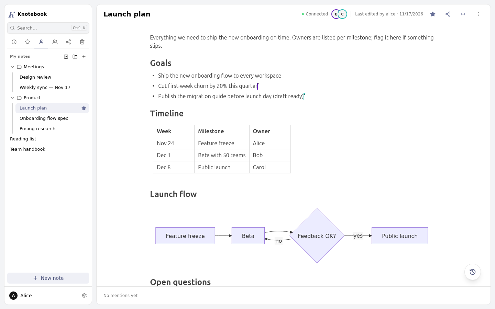
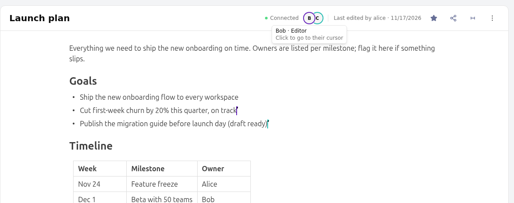
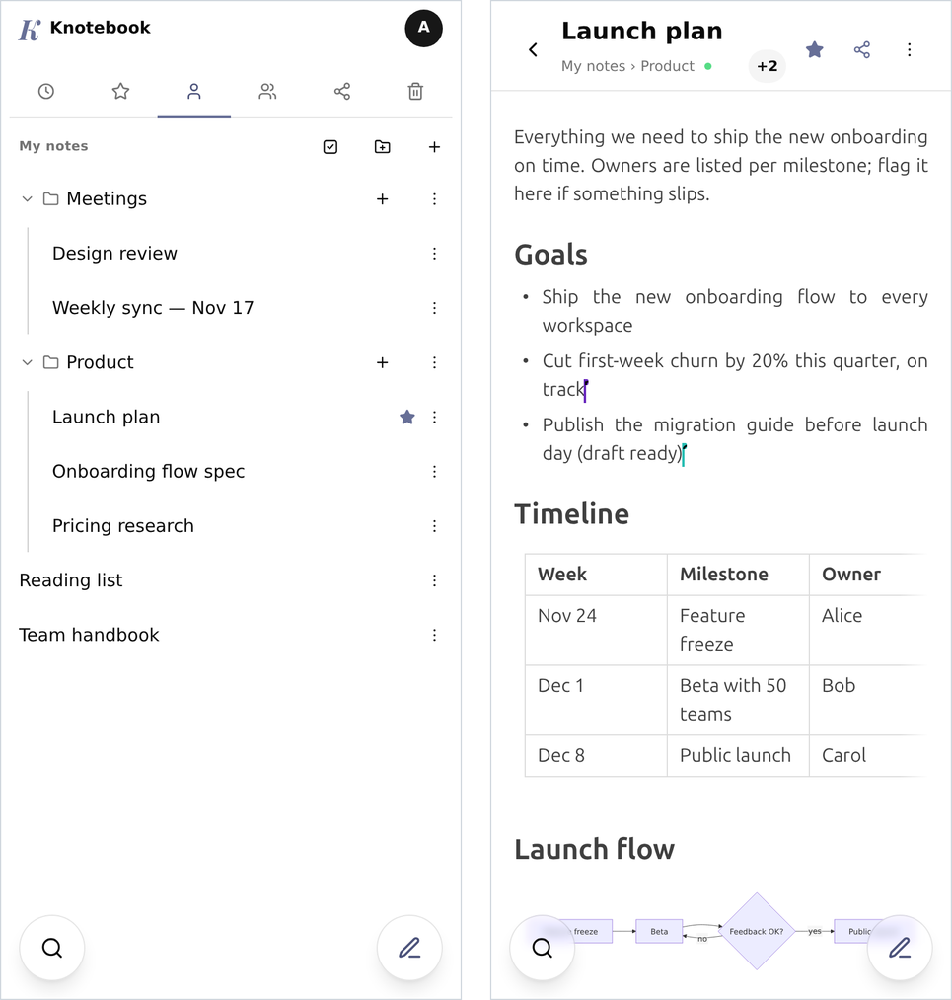

# Knotebook

[](https://github.com/sw-willie-wu/knotebook/releases/latest)
[](https://github.com/sw-willie-wu/knotebook/actions/workflows/ci.yml)
[](LICENSE)

English | [繁體中文](README.zh-TW.md)

**A collaborative knowledge platform for humans and AI agents.** Self-hosted, bring your own models, and the edits agents make are recorded where you can review and revert them.

Your team writes and organizes notes together in real time. The AI assistants you already use, such as Claude Code, Claude Desktop or any other MCP client, search, read and edit the same notes through a built-in MCP endpoint. An agent's edit appears live in every open tab, and each change it makes to a note's content goes into that note's AI edit history, where it can usually be reverted.


It runs as one app container and a PostgreSQL database with `docker compose`, from prebuilt images for linux/amd64 and linux/arm64. The web app is in English and Traditional Chinese, with light and dark themes.

**Status:** the latest release is v0.17.1 (2026-11-18). Every version and its files are on [Releases](https://github.com/sw-willie-wu/knotebook/releases); what changed, and what is on `main` but not released yet, is in the [CHANGELOG](CHANGELOG.md).

## Why Knotebook

Each of these tools does something well that Knotebook doesn't try to do. Knotebook is for a team that wants its notes on its own server, edited live by people and agents, with a record of what the agents changed.

✅ yes · ❌ no · △ partly (see the notes below) · — doesn't apply

| | Obsidian | Notion | HackMD | HedgeDoc | Local agent memory | Knotebook |
|---|:-:|:-:|:-:|:-:|:-:|:-:|
| Notes stay on your own machines or server | ✅ | ❌ | △¹ | ✅ | ✅ | ✅ |
| Real-time co-editing | ❌ | ✅ | ✅ | ✅ | ❌ | ✅ |
| Free for any number of people | △² | ❌ | ❌ | ✅ | ✅ | ✅ |
| Agents can read and write notes | ✅ | ✅ | ✅ | △³ | ✅ | ✅ |
| Each agent edit listed and undone on its own | △⁴ | △⁴ | △⁴ | △⁴ | △⁵ | ✅ |
| AI runs on a model you host (local included) | △⁶ | ❌ | ❌ | ❌ | — | ✅ |
| Works offline as plain local files | ✅ | ❌ | ❌ | ❌ | ✅ | ❌ |
| Databases (tables as data) | △⁷ | ✅ | ❌ | ❌ | ❌ | ❌ |
| Plugins and a graph view | ✅ | ❌ | ❌ | ❌ | ❌ | ❌ |

¹ A hosted service; its pricing lists self-hosting under Enterprise.
² The app is free; shared vaults need Sync, priced per user.
³ Its HTTP API creates and downloads notes but doesn't edit them.
⁴ Version history of a whole note or file (Notion's marks what its AI changed): you go back to an earlier version rather than undo one edit.
⁵ Files such as CLAUDE.md or memory files: if they are in git, each commit can be reverted.
⁶ Through community plugins.
⁷ Bases shows note properties as database-style views.

**How Knotebook does it**

- **Your server**: one app container and PostgreSQL with `docker compose` ([Self-hosting guide](docs/self-hosting.md)).
- **Co-editing**: everyone edits at once and sees each other's cursors and who has the note open.
- **Any number of people**: MIT-licensed, with no seat limits or license gate.
- **Agents**: a built-in MCP endpoint with up to twenty tools, and notes as Markdown files for agents with a shell ([MCP](docs/mcp.md)).
- **Agent edits**: each one goes into the note's AI edit history and can usually be reverted on its own ([Revert](docs/ai-editing.md#revert)).
- **AI in the editor**: a site admin points it at a model you host through any OpenAI-compatible API (Ollama, vLLM and others), or at Anthropic ([AI quick actions](docs/ai.md)).

There is no hosted service to sign up for: you run it yourself, and even installed as an app it needs its server. It currently runs as a single `app` container only ([Single-instance warning](docs/self-hosting.md#single-instance-warning)).

## What you can do with it

Each part below lists what works today and what is planned. Planned items are what we intend to build, with no promises or dates; [issues](https://github.com/sw-willie-wu/knotebook/issues) and [milestones](https://github.com/sw-willie-wu/knotebook/milestones) track them.

### Write and organize notes together


**Works today**

- **Block editor**: headings, lists, tables, quotes, code blocks with syntax highlighting, a `/` menu to insert blocks and Markdown shortcuts as you type; text, background and table cell colors (nine built-in colors, or any color you pick); Standard, Wide or Full width per note.
- **Real-time co-editing**: everyone on a note edits at once (Yjs and Hocuspocus) and sees the other editors' cursors; the note header shows who else has it open, and clicking someone's avatar goes to their cursor.
- **Links between notes**: type `[[`, or paste or drag in a note's address; links follow renames, can point at a single paragraph, and each note lists the notes that mention it.
- **Images and diagrams**: PNG, JPEG, GIF and WebP images you can resize, counted toward the storage plan of the note's space; Mermaid diagrams stored as their source text ([Diagrams](docs/diagrams.md)); both zoom full screen.
- **Side-by-side columns**: rows of two to four columns, made with `/grid` or by dragging a block beside another, resized by dragging the divider ([Side-by-side columns](docs/columns.md)).
- **Heading outline**: a thin line on the right of a note with one tick per heading (H1 to H3); hover or tap it to see the headings and jump to one. On a wide enough window it can be pinned open beside a Standard-width note; on a phone or a window narrower than 768 px, a bubble shows where you are while you scroll and opens the list, and so does **Heading outline** in the note's `⋮` menu.
- **Knowledge info**: a heading can carry when to read it, a one-line conclusion, its basis, when it was last verified and whether it is current, needs review or outdated, shown as a small status icon after the heading, with an index of it for each folder and space ([Knowledge info](docs/knowledge.md), [the index](docs/knowledge.md#the-index)).
- **Version history**: versions saved automatically after a pause in editing, or by hand; preview one, compare two side by side, and apply an older one ([Version history](docs/versions.md)).
- **Presentation mode**: play a note as a slide show whose slides are its headings, from the note or from its public link.
- **Search**: the sidebar finds notes by title and body text and opens a note at the matching section; the REST API and MCP search the same way ([MCP](docs/mcp.md#search_notes)).
- **Folders, favorites, tags and trash**: folders up to five levels deep in your notes, in each group and, for you alone, among the notes shared with you, filled with **Move to…**, by selecting several notes, or by dragging with a mouse ([Folders](docs/sharing.md#folders)); favorites that are yours alone ([Favorites](docs/sharing.md#favorites)); tags that label notes, shown above the text and as colored dots and a filter in the sidebar ([Tags](docs/sharing.md#tags)); a trash that keeps deleted notes for 7 days unless a site admin sets another number of days or turns that off ([Notes in the trash](docs/sharing.md#notes-in-the-trash)).
- **Sharing and groups**: a personal note is private, shared with chosen people as editors or viewers, or published as a read-only public link, which can have a custom address ([Sharing](docs/sharing.md)); a group owns its notes, and what a member can do comes from their role, built in (Admin, Member) or custom ([Notes in a group](docs/sharing.md#notes-in-a-group)).

**Planned**

- Attaching audio, video and documents, not only images ([#249](https://github.com/sw-willie-wu/knotebook/issues/249)); a reference library that AI can cite ([#71](https://github.com/sw-willie-wu/knotebook/issues/71)).
- Importing an Obsidian vault, a Notion export or Markdown files, with `[[links]]` turned into links between notes.

### Let agents work on the same notes

**Works today**

- **MCP endpoint**: `/api/mcp` gives Claude Code, Claude Desktop and other MCP clients up to twenty tools to search, read a note section by section, create, edit, rename, copy and move notes, manage folders, move notes to the trash and back, and read images ([MCP](docs/mcp.md)).
- **Notes as files**: with `open_notes_as_files`, an assistant that has a shell downloads many notes as Markdown files and sends the changed files back; only the parts a file changed are written ([MCP](docs/mcp.md#open_notes_as_files)).
- **Knowledge info and tags for agents**: agents read and write knowledge info as a comment under each heading, and set tags through a file's `tags:` line ([AI editing](docs/ai-editing.md#knowledge-info)).
- **API tokens and OAuth**: personal API tokens with scopes, or apps you authorize over OAuth, which are read-only unless you allow more ([API tokens](docs/api-tokens.md)). **Settings → Authorization → Connect Claude with MCP** shows ready-to-paste setup for your server.
- **AI quick actions in the editor**: select text and run Rewrite, Translate, Summarize, Continue writing or Instruct (follows an instruction you type), with the result shown as an inline diff, streamed from a provider a site admin sets up: any OpenAI-compatible API (including a local Ollama) or Anthropic. Nothing is sent anywhere until an admin sets one up, and admins can rename, turn off or add actions ([AI quick actions](docs/ai.md)).
- **REST API**: the web app runs on a REST API you can call yourself, including reading and writing note content by section ([AI editing](docs/ai-editing.md), [API contract summary](docs/api.md)).

**Planned**

- Search for agents that answers with index lines first (when to read, conclusion, last verified), so an agent reads only the one or two most relevant notes.
- Writing back: an agent puts new findings in a place to be sorted, or suggests changes to an existing note.
- Search with several keywords, ranked by how well notes match ([#399](https://github.com/sw-willie-wu/knotebook/issues/399)); semantic search ([#92](https://github.com/sw-willie-wu/knotebook/issues/92)).
- Comments, @mentions (including mentioning an agent) and notifications ([#289](https://github.com/sw-willie-wu/knotebook/issues/289)).
- A built-in agent and chat in the app ([#264](https://github.com/sw-willie-wu/knotebook/issues/264), [#118](https://github.com/sw-willie-wu/knotebook/issues/118)).

### See and undo what agents change

**Works today**

- **AI edit history**: a write through the API or MCP that changes a note's content shows up live in open tabs and is recorded in the note's AI edit history (in the note's `⋮` menu), with whose account made it and the agent's name. Each note keeps up to its 100 most recent AI edits, and an edit can usually be reverted as long as the part of the note it wrote hasn't been changed again. Renaming a note and creating one aren't recorded ([Revert](docs/ai-editing.md#revert)).
- **Agents show up in the note**: while an agent connected with a token or an authorized app reads or writes a note that someone has open, it appears as a cursor labelled with your username and the agent's name, and in the note header's row of people as an AI agent ([Presence](docs/ai-editing.md#presence)). You can rename each credential's agent name ([Agent display name](docs/ai-editing.md#agent-display-name)).
- **Version history** lists who changed the note between versions, an agent's changes shown as the person's name followed by the agent's name ([Version history](docs/versions.md)).
- **Scoped access**: a token or app can read only, or also edit; moving notes into groups (which can't be undone) and moving notes to the trash (which can be restored) are separate permissions you turn on for each credential, and a token's access can be changed later ([Changing a token's access](docs/api-tokens.md#changing-a-tokens-access)).
- **Note snapshots**: the server keeps periodic snapshots of note content, and a runbook covers restoring a note from one or from a `pg_dump` ([Restoring note content from a backup](docs/backup-restore.md)).

**Planned**

- **Suggestion mode**: an agent's changes arrive as suggestions that people accept or reject piece by piece.
- **Agent activity overview**: one page showing which agent or token changed which notes over a period, with a way to revert them together.
- **Agents with an identity of their own**: a name and picture for each agent in the row of people and in the records.

### Keep notes up to date without someone watching

**Works today**

- Nothing yet. Agents act only when someone runs them.

**Planned**

- **Scheduled health checks**: broken links, notes not verified for too long, contradictions and duplicates, turned into to-dos or suggestions.
- **Event triggers**: call an agent when a note changes, when it is @mentioned, or when something is uploaded.
- **Turning a session into notes**: write up a conversation or a work log as notes whose headings carry knowledge info.

## For the people running it

- **Docker Compose**: the app and a bundled PostgreSQL, or your own PostgreSQL ([Self-hosting guide](docs/self-hosting.md)).
- **Sign-in**: passwords, and any number of OpenID Connect providers (GitLab, Google or another), which can create an account on someone's first sign-in or be made the only way in; self-registration with a password (on unless a site admin turns it off), invitation links and one-time password-reset links ([Sign-in providers](docs/self-hosting.md#sign-in-providers), [Accounts](docs/self-hosting.md#accounts)).
- **Profile pictures**: upload and crop your own, or use the picture your identity provider sends; it shows on your account button, in the avatars at the top of a note and next to your name in lists such as a group's members.
- **Storage quotas**: every personal space and group is on a storage plan that can cap its attachments ([Storage quotas](docs/self-hosting.md#storage-quotas)).
- **Site admin**: users, groups, sign-in services, storage plans, AI providers, and 17 limits (upload size, note size, request rates and more) that take effect without restarting the server ([Site limits](docs/self-hosting.md#site-limits)).
- **Phone layout**: below 640 px the note list is the home screen, a note slides in from the right over it, dialogs and menus rise from the bottom, and an editing toolbar sits above the on-screen keyboard; from 640 to 1279 px the sidebar is a drawer ([Known limitations](docs/known-limitations/phone.md)).
- **Install as an app**: add Knotebook to a phone's or computer's home screen, or install it from Chrome or Edge; like a browser tab, it needs the server ([Installing Knotebook as an app](docs/install-app.md)).
- **Help and feature tour**: **Help** in the user menu, or Ctrl+/ (⌘/ on a Mac), opens a feature tour on a sample note, What's new, and the keyboard shortcuts ([Help and the feature tour](docs/feature-tour.md)).





<p align="center"></p>

## Quickstart

You need Docker with Compose. This runs Knotebook on `http://localhost:3000`.

1. In an empty directory, download the latest release's compose file and example settings:

   ```sh
   curl -fLO https://github.com/sw-willie-wu/knotebook/releases/latest/download/docker-compose.yml
   curl -fL -o .env https://github.com/sw-willie-wu/knotebook/releases/latest/download/env.example
   ```

   (Or `git clone https://github.com/sw-willie-wu/knotebook.git`, `cd knotebook` and `cp .env.example .env`, to build from source or run `main`.)

2. Fill in four values in `.env`:

   - `APP_SECRET`: 64 or more hexadecimal characters, for example the output of `openssl rand -hex 32`.
   - `PUBLIC_URL=http://localhost:3000`
   - `ADMIN_EMAIL` and `ADMIN_PASSWORD` (12 characters or more): the first admin account. The server won't start on an empty database without them, and they only take effect that first time.

3. Start it, open `http://localhost:3000` and sign in with `ADMIN_EMAIL` and `ADMIN_PASSWORD`:

   ```sh
   docker compose up -d
   ```

Which image runs: a release's `docker-compose.yml` runs that release, the repository's runs `latest`, and `KNOTEBOOK_VERSION` in `.env` pins a release (recommended with a clone). In a clone, `docker compose up -d --build` builds from source instead ([The app image](docs/self-hosting.md#the-app-image)).

To try co-editing, open **Site admin → Users** from the user menu, use **Create invitation**, open the link in a private window to create a second account, and share a note with it.

**Upgrading:** read the new release's upgrade notes in the [CHANGELOG](CHANGELOG.md) first, and back up when they say so. Then replace `docker-compose.yml` with the new release's (or update your clone), change `KNOTEBOOK_VERSION` if you set it, and run `docker compose pull` and `docker compose up -d` ([Upgrading and rolling back](docs/self-hosting.md#upgrading-and-rolling-back)).

### Connect an agent

1. In Knotebook, open **Settings → Authorization → Connect Claude with MCP**. It shows your server's endpoint and ready-to-paste commands.
2. On an `https://` server, Claude Code can authorize over OAuth, with no token to create:

   ```sh
   claude mcp add -s user -t http knotebook https://<your-host>/api/mcp
   ```

   Then type `/mcp` in Claude Code, pick **knotebook** and choose **Authenticate**. Tick *Create and edit notes* on the consent page if the agent should write.
3. On a plain `http://` server, create a personal API token instead and pass it as a header:

   ```sh
   claude mcp add -s user knotebook http://<your-host>/api/mcp -t http -H "Authorization: Bearer knb_…"
   ```

Claude Desktop and other clients, and what each tool does, are in [MCP](docs/mcp.md). To use the AI quick actions in the editor, a site admin adds a provider and a model in **Site admin → AI agents** ([AI quick actions](docs/ai.md)).

## Before you deploy beyond localhost

Read the full [self-hosting guide](docs/self-hosting.md) before running anywhere other than `localhost`. In short:

- **Only run a single `app` container.** `docker compose up --scale app=N` is **not supported**. Real-time collaboration state (Yjs/Hocuspocus) lives in server memory with no cross-instance sync, so scaling out would let edits to the same note **silently diverge** across instances instead of merging. See [Single-instance warning](docs/self-hosting.md#single-instance-warning).
- **`PUBLIC_URL` is required**, and you must pick a topology: **(a)** trusted-LAN plain http, where credentials and the session cookie travel in cleartext, only for a network where you trust every host; or **(b)** reverse proxy + TLS for anything else, including the public internet. See [Deployment prerequisites](docs/self-hosting.md#deployment-prerequisites) for the full trade-offs, the WebSocket-forwarding requirement for `/collab`, and the `TRUST_PROXY` setting you must configure when running behind a proxy.

## Documentation

For people writing notes:

- [Sharing](docs/sharing.md): private, shared and public notes, groups and their roles, moving or copying a note into a group, folders, favorites, tags and the trash.
- [Knowledge info](docs/knowledge.md): when to read, conclusion, basis, verified date and status on headings, and the index.
- [Version history](docs/versions.md): when versions are saved, previewing, comparing and applying them, who sees them and how long they are kept.
- [Side-by-side columns](docs/columns.md): making, resizing, removing, copying and undoing rows of columns.
- [Diagrams (Mermaid)](docs/diagrams.md): inserting, editing, pasting and copying out Mermaid diagrams.
- [Help and the feature tour](docs/feature-tour.md): the Help window, the feature tour, the What's new page and the keyboard shortcuts.
- [Installing Knotebook as an app](docs/install-app.md): adding it to the home screen on Android, iPhone and iPad, and installing it on a computer.
- [Limitations worth knowing](docs/limitations.md): what to know before you deploy Knotebook or trust it with your notes, such as where data can be lost, what can't be undone, security trade-offs and missing features.
- [Known limitations](docs/known-limitations.md): the complete reference of every known rough edge and deliberate trade-off.

For connecting AI and scripts:

- [MCP](docs/mcp.md): connecting an MCP client, what each tool takes and answers, the read-write loop, limits and errors.
- [API tokens](docs/api-tokens.md): creating, using and revoking personal API tokens, and authorizing an app over OAuth instead.
- [AI editing](docs/ai-editing.md): reading and writing note content over the API: sections, fingerprints, the five write operations, reverting and the Markdown format.
- [API contract summary](docs/api.md): every endpoint with its authentication, request body and error codes.

For running a server:

- [Self-hosting guide](docs/self-hosting.md): deployment prerequisites, reverse proxy and TLS, environment variables, site limits, sign-in providers, accounts, storage quotas, the app image, upgrading and rolling back, and troubleshooting.
- [AI quick actions](docs/ai.md): setting up AI providers, models and actions in **Site admin → AI agents**, and how the actions behave in the editor.
- [Restoring note content from a backup](docs/backup-restore.md): restoring a note's content from a snapshot or from a `pg_dump`.

For contributors and maintainers:

- [Contributing](CONTRIBUTING.md): setting up a development environment, the checks a pull request must pass, and the project's conventions.
- [Architecture](ARCHITECTURE.md): a map of the code, from the server and real-time collaboration to the web app and the tests.
- [Running the e2e suite locally](docs/e2e-local.md): the Playwright suite against a throwaway Docker Compose stack in WSL, and running several at once.
- [Releasing](docs/releasing.md): preparing a release pull request with `pnpm release:prepare`, and what the Release workflow does after the merge.
- [CHANGELOG](CHANGELOG.md): every release, with its upgrade notes.

## Contributing

Bug reports and feature requests go in the [issue tracker](https://github.com/sw-willie-wu/knotebook/issues); planning lives in [GitHub Milestones](https://github.com/sw-willie-wu/knotebook/milestones). Pull requests are welcome; to run the end-to-end tests locally, see [Running the e2e suite locally](docs/e2e-local.md). Before your first pull request, read [CONTRIBUTING.md](CONTRIBUTING.md).

## Trademarks

GITLAB is a trademark of GitLab Inc. in the United States and other countries and regions. Google is a trademark of Google LLC. Knotebook is not affiliated with or endorsed by GitLab or Google.

The GitLab and Google sign-in templates only use those names to prefill the issuer URL and display name. Knotebook bundles no vendor logo; an admin can upload their own icon for a service.

## License

MIT, see [LICENSE](./LICENSE). Bundled third-party components (a font asset, jsdiff, BlockNote, Lucide icon paths) carry their own licenses, see [THIRD_PARTY_NOTICES.md](./THIRD_PARTY_NOTICES.md).
