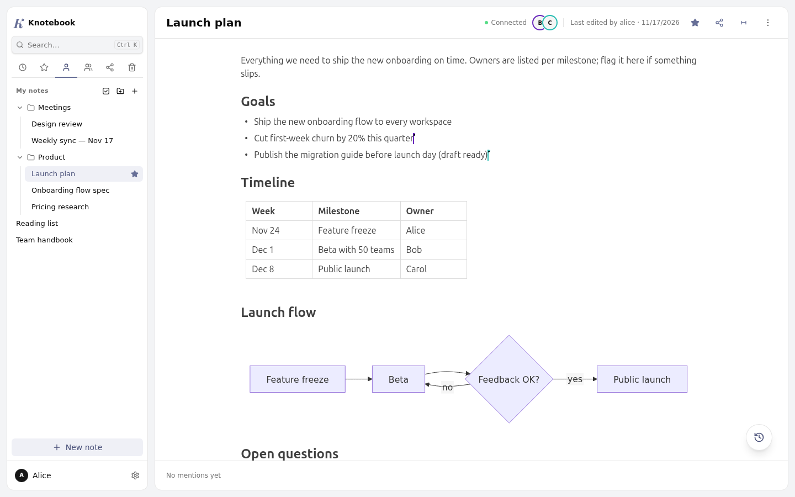
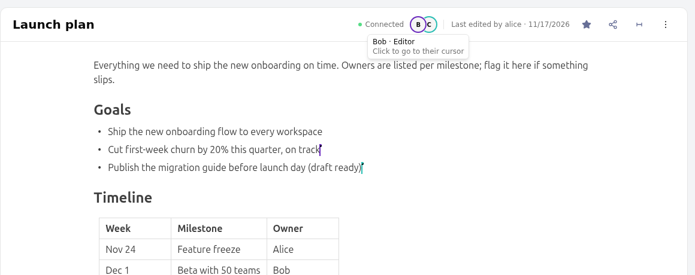
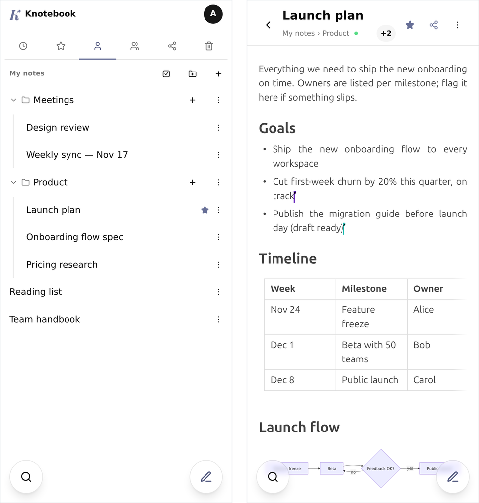

# Knotebook

[](https://github.com/sw-willie-wu/knotebook/releases/latest)
[](https://github.com/sw-willie-wu/knotebook/actions/workflows/ci.yml)
[](LICENSE)

[English](README.md) | 繁體中文

> 本文件為繁體中文（台灣）翻譯版，內容以英文版 [README.md](README.md) 為準，翻譯可能落後於英文版。文中連結的說明文件（docs/ 與 CHANGELOG）目前只有英文版。

**給團隊與團隊的 AI agent 一起用的自架協作筆記。** Knotebook 是一套開源、Notion/HackMD 風格的筆記系統，架在你自己的伺服器上。人可以即時一起編輯筆記；你已經在用的 AI 助理（例如 Claude Code、Claude Desktop 或其他任何 MCP 用戶端）則透過 MCP 端點搜尋、讀取與編輯同一批筆記，它們做的修改會出現在每篇筆記的 AI 修改紀錄裡，通常都能還原。



三項不可妥協的原則：

- **沒有人數上限**——自行架設給一個人或一千個人用都可以，沒有授權門檻。
- **即時 CRDT 協作**——以 Yjs 為基礎的多人同步編輯，不是付費附加功能。
- **自備 AI 端點**——把 Knotebook 指向你自己的 OpenAI 相容或 Anthropic 端點（包含本機／機房內的 Ollama），不綁定任何供應商。

它用 `docker compose` 跑一個 app 容器加一個 PostgreSQL 資料庫，映像是預先建好的（linux/amd64 與 linux/arm64）。網頁介面有英文與繁體中文，並有淺色與深色主題。

**狀態**：最新版本為 v0.15.0（2026-11-10）。每個版本與其附檔都在 [Releases](https://github.com/sw-willie-wu/knotebook/releases)；改了什麼、以及已在 `main` 但尚未發版的內容，見 [CHANGELOG](CHANGELOG.md)。

## 截圖

還有誰開著這篇筆記，以及他們在內文裡的游標：



在手機上，筆記清單就是首頁，筆記會疊在清單上開啟：

<p align="center"></p>

## 功能

### 寫作

- **區塊編輯器**——標題、清單、表格、引言、有語法上色的程式碼區塊、插入區塊用的 `/` 選單，以及打字時的 Markdown 快捷寫法；快捷鍵見 [說明與功能導覽](docs/feature-tour.md)。
- **顏色**——文字、背景與表格儲存格的顏色：內建十種，或任選一種顏色。
- **即時共同編輯**——同一篇筆記上的每個人同時編輯（Yjs 與 Hocuspocus），看得到其他編輯者的游標；筆記頁首顯示還有誰開著這篇，點某人的頭像會跳到他的游標。
- **筆記之間的連結**——打 `[[`，或貼上、拖入筆記網址；連結改名不斷、可以指向單一段落，每篇筆記也會列出提到它的筆記。
- **圖片**——在筆記裡加入 PNG、JPEG、GIF 或 WebP 圖片並調整大小；圖片計入筆記所屬空間的儲存方案。
- **並排**——兩到四欄的並排，用 `/grid` 或把區塊拖到另一個區塊旁邊建立，拖分隔線調整欄寬（[並排](docs/columns.md)）。
- **圖表**——Mermaid 圖表，以原始碼儲存、在筆記裡畫出來（[圖表](docs/diagrams.md)）。
- **筆記寬度**——每篇筆記可設標準、寬或全寬。
- **版本歷史**——編輯停手後自動存版，也可以手動存；預覽版本、左右並排比較兩個版本，或套用較舊的版本（[版本歷史](docs/versions.md)）。
- **簡報模式**——把筆記當簡報播放，標題就是投影片；從筆記或它的公開連結都能播。
- **搜尋**——側邊欄依標題與內文找筆記，並在符合的段落開啟筆記；REST API 與 MCP 也有同樣的搜尋（[API](docs/api.md)、[MCP](docs/mcp.md#search_notes)）。

### 整理與分享

- **資料夾**——最多五層，可以在你的筆記裡、每個群組裡，以及只給你自己看的、別人分享給你的筆記裡建立；用**移動到…**、一次選取多篇，或用滑鼠拖曳把筆記放進去（[資料夾](docs/sharing.md#folders)）。
- **最愛**——幫筆記加星號，它就會留在「最愛」分頁；你的最愛只有你自己看得到（[最愛](docs/sharing.md#favorites)）。
- **垃圾桶**——刪除的筆記會移到垃圾桶，可以還原；預設 7 天後永久刪除，站台管理員可以改天數或關閉自動刪除（[垃圾桶中的筆記](docs/sharing.md#notes-in-the-trash)）。
- **分享與公開連結**——個人筆記可以維持私人、分享給指定的人編輯或檢視，或以唯讀的公開連結發布，公開連結也可以設自訂網址（[分享](docs/sharing.md)）。
- **群組**——群組擁有自己的筆記；成員能做什麼取決於其角色，可以是內建的（管理員、一般成員）或自訂的（[群組中的筆記](docs/sharing.md#notes-in-a-group)）。

### 帳號與管理

- **登入**——帳號密碼，以及任意數量的 OpenID Connect 身分提供者（GitLab、Google 或其他提供者），可設成首次登入時自動建立帳號，或設成唯一的登入方式；帳號密碼自行註冊（除非站台管理員關閉，否則開著）、邀請連結與一次性的密碼重設連結（[登入服務](docs/self-hosting.md#sign-in-providers)、[帳號](docs/self-hosting.md#accounts)）。
- **頭貼**——上傳並裁切自己的照片，或使用身分提供者提供的照片；它會顯示在你的帳號按鈕、你開著的筆記頂端其他人看到的頭像，以及群組成員等清單中你的名字旁邊。
- **容量上限**——每個個人空間與每個群組都屬於一個儲存方案，可以限制附件的總大小（[容量上限](docs/self-hosting.md#storage-quotas)）。
- **站台管理**——使用者、群組、登入服務、儲存方案、AI 供應商，以及 17 項不必重啟伺服器就生效的限制（上傳大小、筆記大小、請求頻率等）（[站台限制](docs/self-hosting.md#site-limits)）。

### AI

- **AI 快速動作**——在選取的文字上執行改寫（Rewrite）、翻譯（Translate）、摘要（Summarize）、續寫（Continue writing）與指示（Instruct，照你輸入的指示做），結果以行內差異顯示，由站台管理員設定的供應商以串流回傳（[AI 快速動作](docs/ai.md)）。
- **MCP**——`/api/mcp` 提供 Claude Code、Claude Desktop 與其他 MCP 用戶端最多二十項工具，可以搜尋、讀取、建立、編輯、改名、複製與搬移筆記，管理資料夾，把筆記移到垃圾桶與還原，以及讀取圖片（[MCP](docs/mcp.md)）。
- **以檔案讀寫筆記**——用 `open_notes_as_files`，有 shell 的 AI 助理可以把大量筆記下載成 Markdown 檔，再把改過的檔案送回（[MCP](docs/mcp.md#open_notes_as_files)）。
- **AI 修改紀錄**——透過 API 或 MCP 對筆記做的編輯會即時出現在已開啟的分頁中，並記錄在該筆記的 AI 修改紀錄裡，通常可以還原（[AI 編輯](docs/ai-editing.md)）。
- **API token 與 OAuth**——可設權限範圍的個人 API token，或透過 OAuth 授權的應用程式（除非你允許更多，否則只能讀取）（[API token](docs/api-tokens.md)）。

### 各種螢幕

- **手機版面**——視窗窄於 640 px 時，筆記清單就是首頁，筆記從右側滑入疊在清單上，對話框與選單從底部升起，螢幕鍵盤上方有編輯工具列；640 到 1279 px 時側邊欄是抽屜（[已知限制](docs/known-limitations.md#on-a-phone)）。
- **安裝成 app**——把 Knotebook 加到手機或電腦的主畫面，或從 Chrome、Edge 安裝；和瀏覽器分頁一樣，它需要連上伺服器（[把 Knotebook 安裝成 app](docs/install-app.md)）。
- **說明與功能導覽**——使用者選單的**說明**，或 Ctrl+/（Mac 為 ⌘/），會開啟說明視窗：在示範筆記上進行的功能導覽、這一版新增，以及快捷鍵（[說明與功能導覽](docs/feature-tour.md)）。

### 架設

- **Docker Compose**——app 加上內建的 PostgreSQL，或改用你自己的 PostgreSQL（[自行架設指南](docs/self-hosting.md)）。
- **REST API**——網頁介面建立在一套你也可以直接呼叫的 REST API 上（[API 規格摘要](docs/api.md)）。
- **備份**——伺服器會定期保存筆記內容的快照，並有操作手冊說明如何從快照或 `pg_dump` 還原筆記（[從備份還原筆記內容](docs/backup-restore.md)）。

## 快速上手

你需要裝有 Compose 的 Docker。以下會讓 Knotebook 跑在 `http://localhost:3000`。

1. 在一個空目錄下載最新 Release 的 compose 檔與範例設定：

   ```sh
   curl -fLO https://github.com/sw-willie-wu/knotebook/releases/latest/download/docker-compose.yml
   curl -fL -o .env https://github.com/sw-willie-wu/knotebook/releases/latest/download/env.example
   ```

   （要從原始碼 build 或跑 `main`，改用 `git clone https://github.com/sw-willie-wu/knotebook.git`、`cd knotebook` 與 `cp .env.example .env`。）

2. 在 `.env` 填入四個值：

   - `APP_SECRET`——一段隨機密鑰，例如 `openssl rand -hex 32` 的輸出。
   - `PUBLIC_URL=http://localhost:3000`
   - `ADMIN_EMAIL` 與 `ADMIN_PASSWORD`（至少 12 個字元）——第一個管理員帳號。資料庫是空的、又沒有設定這兩項時，伺服器會拒絕啟動；它們只在第一次初始化時生效。

3. 啟動後開啟 `http://localhost:3000`，以 `ADMIN_EMAIL` 與 `ADMIN_PASSWORD` 登入：

   ```sh
   docker compose up -d
   ```

跑哪個映像：用 Release 附帶的 `docker-compose.yml` 時是該版本身，用 repo 裡的則是 `latest`；在 `.env` 設 `KNOTEBOOK_VERSION` 可以鎖定某個版本（用 clone 時建議這樣做）。在 clone 裡執行 `docker compose up -d --build` 則改從原始碼 build（[App 映像](docs/self-hosting.md#the-app-image)）。

想試試共同編輯，從使用者選單開啟**站台管理 → 使用者**，用**建立邀請**產生連結，在無痕視窗打開連結建立第二個帳號，再把筆記分享給它。

**升級：**先讀新版在 [CHANGELOG](CHANGELOG.md) 裡的升級說明，說要備份時就先備份。接著用新版的 `docker-compose.yml` 取代舊檔（或更新你的 clone），若設了 `KNOTEBOOK_VERSION` 就改成新版本，再執行 `docker compose pull` 與 `docker compose up -d`（[升級與回滾](docs/self-hosting.md#upgrading-and-rolling-back)）。

## 部署到 localhost 以外之前

要在 `localhost` 以外的地方執行之前，請先閱讀完整的 [自行架設指南](docs/self-hosting.md)——簡單來說：

- **只能執行單一 `app` 容器。**`docker compose up --scale app=N` **不受支援**。即時協作的狀態（Yjs/Hocuspocus）存放在伺服器記憶體中，不同實例之間沒有同步機制，所以橫向擴充會讓同一篇筆記的編輯在各實例之間**悄悄分歧**，而不是合併。見 [單一實例警告](docs/self-hosting.md#single-instance-warning)。
- **`PUBLIC_URL` 為必填**，而且你必須選定一種拓撲：**(a)** 可信任區域網路內的純 http——帳密與 session cookie 以明文傳輸，只適用於你信任網路上每一台主機的環境；或 **(b)** 反向代理加 TLS，其他情況（包含公開網際網路）都用這種。完整的取捨、`/collab` 需要轉送 WebSocket 的要求，以及在代理後方執行時必須設定的 `TRUST_PROXY`，見 [部署前提](docs/self-hosting.md#deployment-prerequisites)。

## 文件

寫筆記的人：

- [分享](docs/sharing.md)——私人、分享與公開的筆記，群組與其角色，把筆記移入或複製到群組，資料夾、最愛與垃圾桶。
- [版本歷史](docs/versions.md)——版本何時儲存，預覽、比較與套用版本，誰看得到、保留多久。
- [並排](docs/columns.md)——建立、調整、拆除、複製與撤銷並排。
- [圖表（Mermaid）](docs/diagrams.md)——插入、編輯、貼上與複製出 Mermaid 圖表。
- [說明與功能導覽](docs/feature-tour.md)——說明視窗、功能導覽與「這一版新增」頁。
- [把 Knotebook 安裝成 app](docs/install-app.md)——在 Android、iPhone 與 iPad 加到主畫面，以及在電腦上安裝。
- [已知限制](docs/known-limitations.md)——已知的粗糙之處與刻意取捨的完整清單。

接上 AI 與腳本：

- [MCP](docs/mcp.md)——連接 MCP 用戶端、每項工具收什麼與回什麼、讀寫流程、限制與錯誤。
- [API token](docs/api-tokens.md)——建立、使用與撤銷個人 API token，以及改用 OAuth 授權應用程式。
- [AI 編輯](docs/ai-editing.md)——透過 API 讀寫筆記內容：段落、指紋、五種寫入操作、還原與 Markdown 格式。
- [API 規格摘要](docs/api.md)——每個端點的驗證方式、請求內容與錯誤碼。

架設伺服器：

- [自行架設指南](docs/self-hosting.md)——部署前提、反向代理與 TLS、環境變數、站台限制、登入服務、帳號、容量上限、App 映像、升級與回滾，以及疑難排解。
- [AI 快速動作](docs/ai.md)——在**站台管理 → AI 代理**設定 AI 供應商、模型與動作，以及這些動作在編輯器裡的行為。
- [從備份還原筆記內容](docs/backup-restore.md)——從快照或 `pg_dump` 還原筆記內容。

貢獻者與維護者：

- [在本機跑 e2e 測試](docs/e2e-local.md)——在 WSL 裡對一套用完即丟的 Docker Compose 環境跑 Playwright 測試，以及同時跑好幾套。
- [發版流程](docs/releasing.md)——用 `pnpm release:prepare` 準備發版 PR，以及 merge 後 Release workflow 自動做的事。
- [CHANGELOG](CHANGELOG.md)——每個版本與其升級說明。

## 路線圖

接下來：

- 筆記留言、@ 提及與通知（[#289](https://github.com/sw-willie-wu/knotebook/issues/289)）
- 放大檢視圖片與 Mermaid 圖（[#462](https://github.com/sw-willie-wu/knotebook/issues/462)）
- 筆記旁的標題導覽（[#465](https://github.com/sw-willie-wu/knotebook/issues/465)）

規劃記錄在 [GitHub Milestones](https://github.com/sw-willie-wu/knotebook/milestones) 與 [issue tracker](https://github.com/sw-willie-wu/knotebook/issues) 中；歷程見 [CHANGELOG](CHANGELOG.md)。

## 授權

MIT——見 [LICENSE](./LICENSE)。隨附的一個字型資源有其自己的授權——見 [THIRD_PARTY_NOTICES.md](./THIRD_PARTY_NOTICES.md)。
